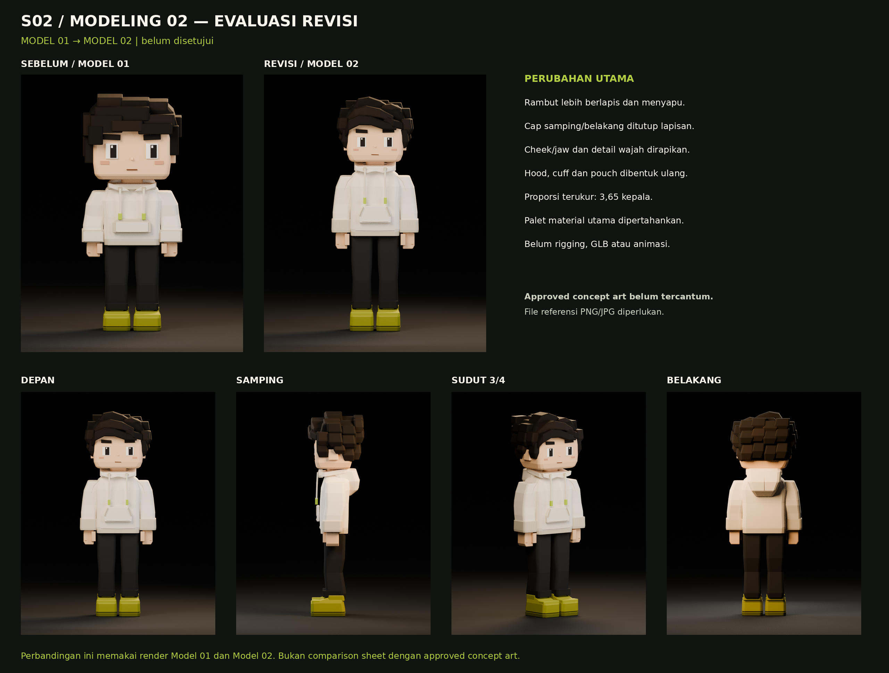

# Season 02 — Modeling revision 02

**Unapproved shape review. No armature, expressions rig, GLB export or animation.**

This revision loads the preserved `modeling-01` Blender file and writes only into this new directory. Original Season 01 and all earlier Season 02 work remain unchanged.

## Artifacts

| Review | File |
| --- | --- |
| Front / depan | [front.png](evaluation/front.png) |
| Side / samping | [side.png](evaluation/side.png) |
| Three-quarter / 3/4 | [three-quarter.png](evaluation/three-quarter.png) |
| Back / belakang | [back.png](evaluation/back.png) |
| Four views, native pixel scale | [four-views-native.png](evaluation/four-views-native.png) |
| Model 01 → 02 with notes | [revision-review-sheet.png](evaluation/revision-review-sheet.png) |
| Editable Blender source | [s02-character-modeling-02.blend](source/s02-character-modeling-02.blend) |

Each individual render is 960×1200. The revision sheet compares actual Model 01 and Model 02 renders; it **does not contain the approved concept art**. Measurements, audit and known limitations are in `docs/`.



## Changes

Hair foundation reshaped and covered with directional sweep ribbons, staggered tapered temple/side/nape/crown tufts. Face receives a more contoured cheek/jaw perimeter, restrained two-segment edge refinement and retuned rectangular eyes, brows, blush and minimal mouth. Hoodie has a draped hood, hollow neckline, tapered front fold, shaped pouch with hand-entry seams, continuous elbow contours, cuff rib geometry and connected closed cord tubes. Main material palette is inherited unchanged.

The head remains uniformly scaled to preserve facial aspect. Body height is adjusted to achieve **3.65 head heights**, using crown-to-chin as one head and floor-to-crown as total height. This is deliberately taller than Model 01, as requested. The illustrated sheet and its numerical note are not treated as a calibrated orthographic measurement.

## Missing approved-reference bitmap

The approved design sheet remains visible in chat and was used for visual judgment, but no PNG/JPG binary of that image is available in the attached workspace. No artificial recreation was pasted into a comparison and no fake comparison is claimed. To produce the exact requested reference comparison, supply the actual approved image file, then run:

```sh
python scripts/make_review_sheets.py --concept /absolute/path/to/approved-sheet.png
```

This generates `evaluation/approved-concept-comparison.png` using the exact supplied image, all four current renders and change notes.

## Rebuild / render

From this directory (Blender 4.3.2, Pillow for sheet layout):

```sh
blender -b -t 2 --python scripts/revise_character.py -- front side three-quarter back
blender -b source/s02-character-modeling-02.blend -t 1 --python scripts/audit_model.py
python scripts/make_review_sheets.py
```

One render process at a time, two CPU threads, 96 Cycles samples, no unavailable OpenImageDenoise. Small diagnostic renders stay in workspace scratch, outside Git.

Clean closed static meshes are not a claim of production-ready deformation topology or approved visual fidelity. The cloth micro-bump remains procedural Blender shading and would need deliberate treatment for a later glTF export. Stop here for shape review; do not advance to rigging or animation.
