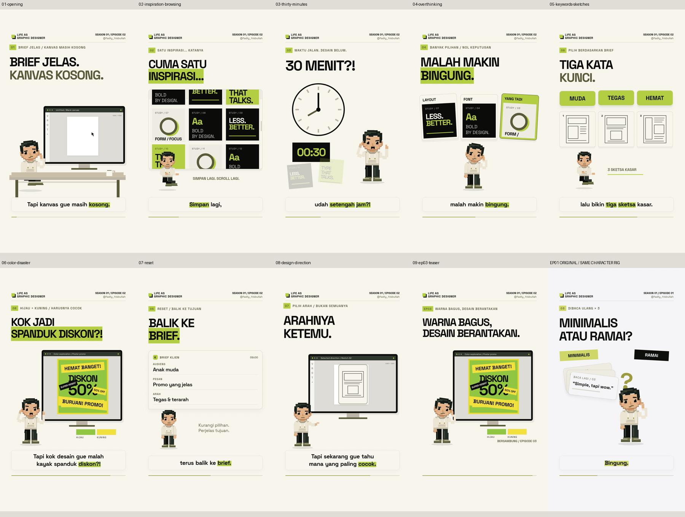

# Episode 02 — evaluation preview

**Cari Inspirasi, Malah Overthinking!** · @fadly_hisbullah

[**Download the complete MP4 preview**](ep02-full-preview.mp4?raw=true)

540×960 · 30fps · **55.000 seconds** · H.264 baseline + AAC stereo 48kHz · 3.8MB.

The MP4 is downloadable; if GitHub does not play it inline, use the download link and open it in your device's video player.

[Source branch](https://github.com/fadly-ullah/life-as-designer/tree/episode02/inspiration-overthinking/life-as-graphic-designer-ep02) · [Verified source commit](https://github.com/fadly-ullah/life-as-designer/commit/b19236ec8ea1410621d38c8afbd4a6a9569df83a)

## Visual checks

[Original EP01 / EP02 visual comparison](ep01-ep02-comparison.jpg) · [Encoded timeline samples](encoded-timeline.jpg) · [All requested PNG frames](visual-check)

## Validation

- Original EP01 articulated SVG character, expressions, original CSS and bundled font preserved. EP01/V2 sources unchanged.
- Supplied EP02 voice-over **51.487313 seconds**, unmodified and untrimmed. 36 phrase subtitle cues, maximum two lines; native ASR phrase timestamps/waveform review, without phoneme timing claims.
- Actual VO correlation at beginning/middle/end: **0ms** measured offset.
- Full decode passed, 1650 frames, no black intervals. Loudness **−16.0 LUFS**, true peak **−1.3dBTP**, no clipping.
- Chromium playback/seek tests passed; full 55-second playback at normal speed, no player errors or dropped frames.
- [Technical report](verification-preview.json) · [Player report](player-verification.json) · [Subtitle SRT](episode02-subtitles.srt) · [Asset hashes](manifest.json)

This branch publishes the evaluation artifacts separately from the development source. Temporary mixes, node_modules, caches, credentials and source recordings from other episodes are not included in this artifact folder.

**Final 1080×1920 movie export has not been rendered. Explicit user preview approval is pending.**
