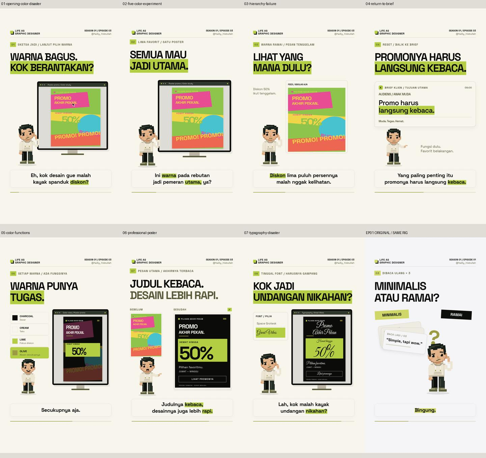

# Episode 03 — evaluation preview

**Warna Bagus, Desain Berantakan!** · @fadly_hisbullah

[**Download the complete MP4 preview**](ep03-full-preview.mp4?raw=true)

540×960 · 30fps · **58.000 seconds** · H.264 baseline/yuv420p · AAC stereo 48kHz · faststart.

If GitHub does not play the video inline, download the MP4 and open it with your device's video player.

[Source project / feature branch](https://github.com/fadly-ullah/life-as-designer/tree/feature/ep03-color-story/life-as-graphic-designer-ep03) · [Source commit](https://github.com/fadly-ullah/life-as-designer/commit/2725e02f9c0a3c2e26bf07713171fd442c767d49)

## Visual checks

[EP01/EP03 comparison](ep01-ep03-comparison.jpg) · [Encoded timeline samples](encoded-timeline.jpg) · [All representative PNGs](visual-check)

The seven required storyboard moments and three supplementary frames were checked. The same fictional poster progresses from five conflicting colors to charcoal/cream/lime hierarchy, then an unsuitable script font creates the EP04 cliffhanger. The original character and global typography remain intact. Conflicting colors and script font are confined to fictional artwork/design-tool examples.

## Verified preview

- Source VO: **54.282438 seconds**, original bytes and speed/pitch, narration not trimmed.
- 1740 frames / 58 seconds; 26 Indonesian phrase subtitles based on local ASR and measured speech/pause boundaries, maximum two lines. No phoneme or forced word alignment is claimed.
- VO correlation at beginning/middle/end: measured **0ms** offset.
- Full decode passed, no black intervals or clipping. Loudness **-16.1 LUFS**, true peak **-1.3dBTP**.
- Chromium successfully sought to 20 points and played the complete 58-second MP4 at normal speed without errors.
- [Technical report](verification-preview.json) · [Player report](player-verification.json) · [SRT subtitles](episode03-subtitles.srt) · [SHA256 manifest](manifest.json)

The 219 protected EP01/V2/EP02 source files remain unchanged. Evaluation artifacts are published separately from the feature source branch; dependencies, caches, temporary mixes and credentials are excluded.

**No final 1080×1920 EP03 movie has been rendered. Explicit user preview approval is pending.**
