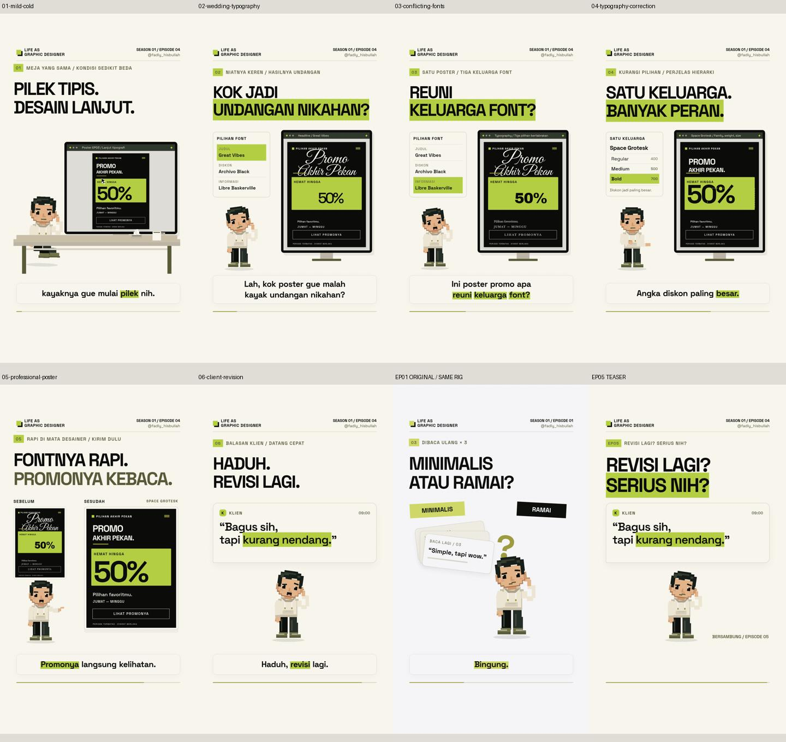

# Episode 04 — evaluation preview

**Gara-gara Font, Desain Jadi Aneh!** · @fadly_hisbullah

[**Download the complete MP4 preview**](ep04-full-preview.mp4?raw=true)

**61.000 seconds** · 540×960 · 30fps · H.264 baseline/yuv420p · AAC stereo 48kHz · faststart.

If GitHub does not play the MP4 inline, download it and open it with your device's video player.

[Source feature branch](https://github.com/fadly-ullah/life-as-designer/tree/feature/ep04-typography-story/life-as-graphic-designer-ep04) · [Verified source commit](https://github.com/fadly-ullah/life-as-designer/commit/6027c8e9a3a3dd0813b081234e57d9fca88eac29)

## Visual review

[EP01/EP04 comparison](ep01-ep04-comparison.jpg) · [Encoded timeline samples](encoded-timeline.jpg) · [All 12 representative PNGs](visual-check)

Six connected scenes continue the same poster project: mild-cold workstation acting, wedding-like typography, three conflicting font families, progressive repair with one family/weight/size/spacing, designer's send, then ambiguous client feedback and the EP05 cliffhanger. Original character geometry, colors and editorial type remain intact. The tissue is a small desk prop; no new character art or exaggerated facial changes.

## Verified preview

- Original nasal VO file: **59.424s FFprobe / 59.381s decoded**, source bytes preserved; no trim, pitch/time alteration, extra nasal EQ, added dialogue or duplicated sniffles/breaths.
- **1830 frames / 61s**, including a short natural ending. 30 phrase subtitle cues follow native ASR and measured speech/pause boundaries. No word/phoneme alignment claim.
- Typography changes use live SVG text in the same poster, not replacement images. Surrounding interface/subtitles remain Space Grotesk.
- VO correlation at beginning/middle/end shows **0ms** measured offset.
- Full decode passed; no black intervals or clipping. Loudness **-16.0 LUFS**, true peak **-1.6dBTP**.
- Chromium successfully sought to 24 points and played the full 61-second preview at normal speed without player errors.
- [Technical report](verification-preview.json) · [Player report](player-verification.json) · [SRT captions](episode04-subtitles.srt) · [SHA256 manifest](manifest.json)

All 317 protected EP01/V2/EP02/EP03 source files remain unchanged. Source backup is on the feature branch; evaluation artifacts are published separately. Dependencies, caches, temporary mixes and credentials are excluded.

**Final 1080×1920 EP04 movie has not been rendered. Explicit user preview approval is pending.**
