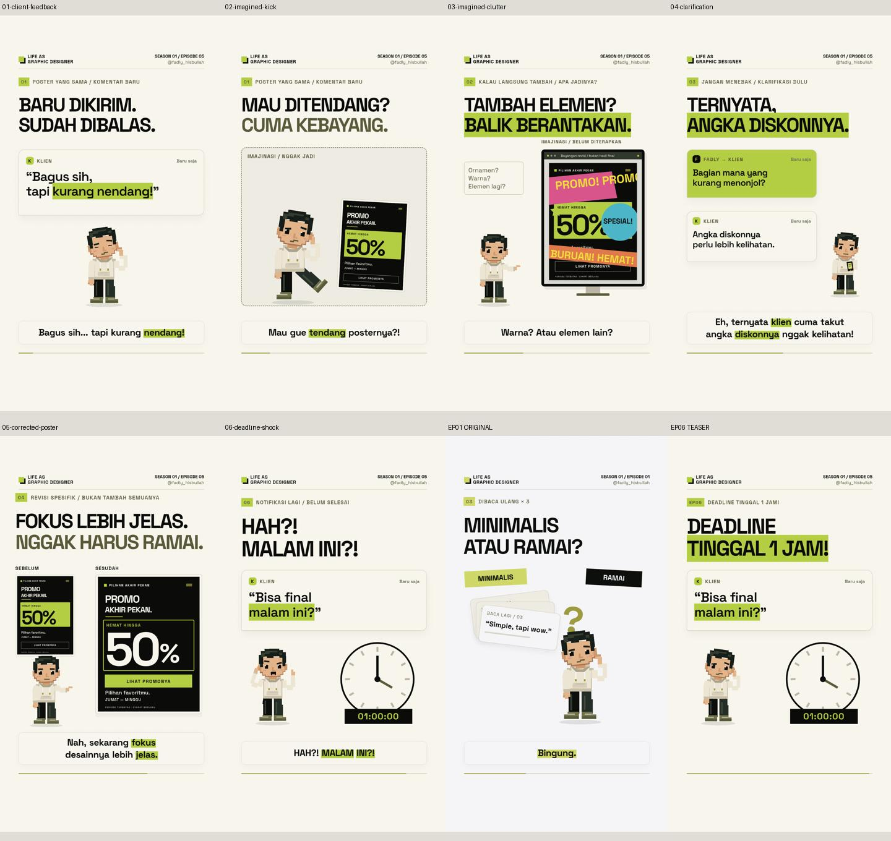

# Episode 05 — preview evaluasi

**Revisi Lagi? Serius Nih?!** · @fadly_hisbullah

[**Unduh MP4 preview lengkap**](ep05-full-preview.mp4?raw=true)

**56 detik** · 540×960 · 30fps · H.264 baseline/yuv420p · AAC stereo 48kHz · faststart.

Jika GitHub tidak memutar video langsung, unduh MP4 dan buka di pemutar video perangkat.

[Source EP05](https://github.com/fadly-ullah/life-as-designer/tree/feature/ep05-client-revisions/life-as-graphic-designer-ep05) · [Commit source](https://github.com/fadly-ullah/life-as-designer/commit/c1752ca6d1f1bf6d766f036464e4e7d9fac5a530)

## Perbandingan visual

[EP01 dan EP05](ep01-ep05-comparison.jpg) · [25 titik video hasil encode](encoded-timeline.jpg) · [Pemeriksaan tambahan](additional-story-checks.jpg) · [12 PNG adegan](visual-check)



Enam adegan meneruskan poster EP04: feedback ambigu, kebingungan revisi, klarifikasi, pembesaran diskon/kontras/CTA, persetujuan klien, lalu permintaan final malam ini. Karakter menggunakan rig SVG pixel-art EP01, tipografi, warna, proporsi dan identitas editorial asli. Tidak ada penggantian model karakter.

Hampir menendang poster hanya terjadi dalam potongan singkat berlabel **IMAJINASI / NGGAK JADI**. Kaki dan sepatu asli tetap tersambung; kaki berhenti sebelum menyentuh poster dan tidak mengarah ke orang. Versi poster berlebihan juga diberi label imajinasi, lalu kembali ke desain asli sebelum revisi nyata. Klien ditampilkan sebagai pihak yang membutuhkan diskon lebih menonjol, bukan antagonis.

## Hasil validasi

- VO WAV lampiran **53.090958 detik** dipertahankan byte-identik. Komposisi memainkan WAV asli satu kali; MP3 tersedia sebagai turunan kompatibilitas. Tidak ada penggantian suara, pemotongan ucapan, perubahan tempo atau pitch.
- **1680 frame / 56 detik**, termasuk jeda akhir alami untuk teaser **EP06: DEADLINE TINGGAL 1 JAM!**
- **28 subtitle frasa** mengikuti timestamp ASR lokal dan jeda terukur. Tidak ada klaim lip-sync fonem atau timing per kata.
- Pemeriksaan korelasi VO pada awal/tengah/akhir menunjukkan offset **0 ms**.
- Decode penuh berhasil; tidak ditemukan frame hitam atau audio clipping. Loudness **-16.0 LUFS**, true peak **-2.3 dBTP**.
- Pemutar Chromium berhasil seek ke **25 titik**, lalu memutar seluruh **56 detik** pada kecepatan normal tanpa error dan dengan **0 dropped frames**. Autoplay browser memakai mute; audio diuji terpisah melalui decode, korelasi dan pengukuran mix.
- **421 file proyek episode sebelumnya** tetap sama. Pemeriksaan TypeScript, identitas karakter dan sumber audio lulus.
- Musik instrumental serta SFX dibuat secara original/prosedural dengan ducking VO dan jeda komedi.

[Laporan teknis](verification-preview.json) · [Laporan pemutar](player-verification.json) · [Review visual](visual-review.json) · [Subtitle SRT](episode05-subtitles.srt) · [Manifest SHA256](manifest.json)

Jalankan dari direktori source EP05:

```sh
npm ci
npm run dev -- --no-open
# Remotion Studio: port 3009, LifeAsGraphicDesignerEP05
npm run render:preview
npm run preview:video
# Pemutar MP4: port 3010
```

Ikuti README source untuk dependensi Python dan prosedur review PNG sebelum render ulang. Concurrency maksimum 2. Source disimpan di branch feature; artefak evaluasi tetap ini dipublikasikan terpisah. node_modules, cache, mix sementara dan kredensial tidak disertakan.

**Final 1080×1920 belum dirender. Menunggu persetujuan eksplisit atas preview lengkap ini.**
