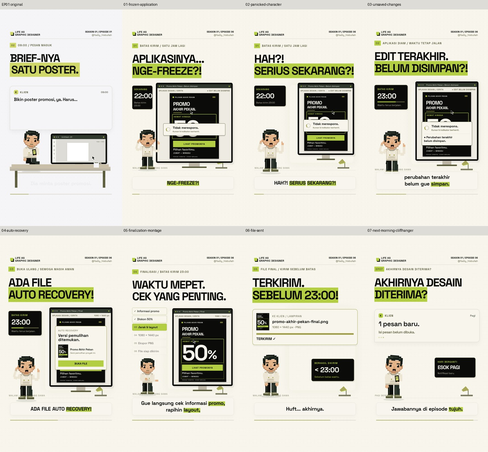

# Episode 06 — preview evaluasi

**Deadline Tinggal 1 Jam!** · @fadly_hisbullah

[**Unduh MP4 preview lengkap**](ep06-full-preview.mp4?raw=true)

**59 detik** · 540×960 · 30fps · H.264 baseline/yuv420p · AAC stereo 48kHz · faststart.

Jika GitHub tidak memutar video langsung, unduh MP4 dan buka dengan pemutar video perangkat.

[Source EP06](https://github.com/fadly-ullah/life-as-designer/tree/feature/ep06-deadline-crisis/life-as-graphic-designer-ep06) · [Commit source](https://github.com/fadly-ullah/life-as-designer/commit/4a03a9aecf218be6c1496786dee6266b02bc6884)

## Visual dan cerita

[Perbandingan EP01/EP06](ep01-ep06-comparison.jpg) · [13 PNG checkpoint](visual-check) · [Pemeriksaan tambahan](additional-story-checks.jpg) · [Timeline hasil encode](encoded-timeline.jpg)



Enam adegan meneruskan poster final EP05: aplikasi macet, perubahan belum disimpan, Auto Recovery, pemeriksaan akhir/ekspor, upload terkirim, lalu notifikasi pagi. Karakter memakai rig SVG pixel-art EP01 dengan wajah, proporsi, rambut, pakaian, warna dan tipografi asli.

Aplikasi macet disimulasikan lewat kursor dan indikator yang berhenti; tidak ada browser atau proses render yang sengaja dimacetkan. Panel pemulihan membuka kembali poster yang sama. Peristiwa pemulihan adalah kejadian fiktif di cerita.

Jam awal menunjukkan **22:00**, kemudian deadline **23:00** dengan bar kualitatif. File terkirim ditandai **< 23:00**, tanpa menit pengiriman yang dibuat-buat. Transisi berikutnya menunjukkan **ESOK PAGI**. Pesan klien tetap belum dibuka; teaser **EP07: AKHIRNYA DESAIN DITERIMA?** tidak mengungkap keputusan klien.

## Hasil pemeriksaan

- VO WAV asli **56.610958 detik** dipertahankan byte-identik dan dimainkan satu kali. MP3 hanya turunan kompatibilitas. Ucapan tidak dipotong, dipercepat, diganti atau diubah pitch-nya.
- **1770 frame / 59 detik**, termasuk jeda penutup alami.
- **33 subtitle frasa** mengikuti hasil ASR lokal dan jeda terukur. Bukan lip-sync fonem atau timing per kata.
- Korelasi VO awal/tengah/akhir: offset terukur **0 ms**.
- Decode penuh berhasil; tidak ditemukan frame hitam atau clipping. Loudness **-16.1 LUFS**, true peak **-1.0 dBTP**.
- Browser berhasil seek ke **33 titik**, lalu memutar seluruh **59 detik** pada kecepatan normal tanpa error. Dropped frames: **0**. Autoplay memakai mute; audio diuji terpisah melalui decode, korelasi dan pengukuran mix.
- **531 file episode sebelumnya** tetap sama. TypeScript dan pemeriksaan identitas lulus.
- Musik instrumental 96 BPM dan efek baru dibuat secara prosedural; SFX seri asli dipakai kembali. VO tetap dominan.

[Laporan teknis](verification-preview.json) · [Pemutar](player-verification.json) · [Review visual](visual-review.json) · [Subtitle SRT](episode06-subtitles.srt) · [Manifest SHA256](manifest.json)

Dari direktori EP06:

```sh
npm ci
npm run dev -- --no-open
# Studio: port 3011, LifeAsGraphicDesignerEP06
npm run render:preview
npm run preview:video
# Pemutar MP4: port 3012
```

Ikuti README source untuk dependensi Python dan prosedur review visual sebelum render ulang. Concurrency maksimum 2. Source dan artefak evaluasi tetap disimpan pada branch terpisah; dependensi, cache, rahasia dan render sementara tidak disertakan.

**Final 1080×1920 belum dirender. Menunggu persetujuan eksplisit atas preview lengkap ini.**
