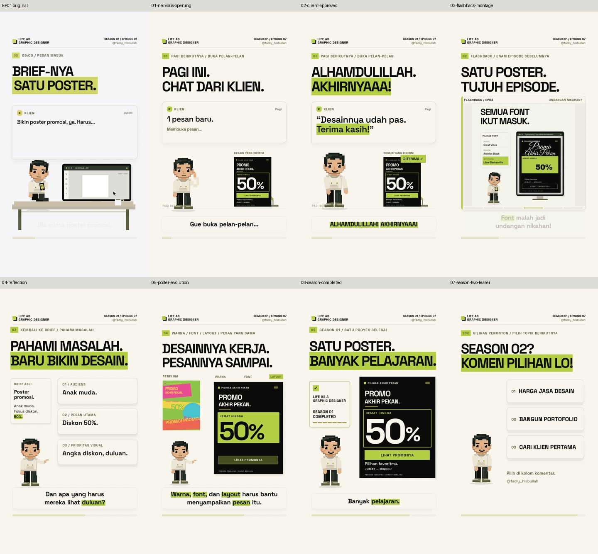

# Episode 07 — Season 01 Finale / preview evaluasi

**Akhirnya Desain Diterima!** · @fadly_hisbullah

[**Unduh MP4 preview lengkap**](ep07-full-preview.mp4?raw=true)

**68 detik** · 540×960 · 30fps · H.264 baseline/yuv420p · AAC stereo 48kHz · faststart.

VO asli berdurasi **65.410563 detik**, lebih panjang dari target konseptual satu menit. Seluruh ucapan dipertahankan tanpa pemotongan atau percepatan; durasi preview mencakup penutup alami. Jika video tidak diputar langsung di GitHub, unduh MP4 dan buka dengan pemutar video perangkat.

[Source EP07](https://github.com/fadly-ullah/life-as-designer/tree/feature/ep07-season-finale/life-as-graphic-designer-ep07) · [Commit source](https://github.com/fadly-ullah/life-as-designer/commit/393220040d6d92fb4c30545fb693f94eae6651c8)

## Visual dan kontinuitas

[Perbandingan EP01/EP07](ep01-ep07-comparison.jpg) · [19 PNG checkpoint](visual-check) · [Pemeriksaan tambahan](additional-story-checks.jpg) · [Timeline video hasil encode](encoded-timeline.jpg)



Enam adegan: persetujuan klien, flashback enam episode, pelajaran dari brief, evolusi keputusan desain, penutupan Season 01, dan pilihan Season 02. Karakter memakai rig SVG pixel-art EP01 yang sama, tanpa perubahan wajah, rambut, pakaian, proporsi atau warna.

Flashback memakai **enam cuplikan animasi asli** dari render EP01–EP06 yang benar-benar tersedia. Audio lama dihapus, subtitle lama tidak ditampilkan. In-point EP01 dipilih agar momen “HARUS WOW!” dan reaksi karakter terlihat jelas. [Provenance cuplikan](flashback-provenance.json) mencatat sumber, hash, in-point dan crop.

Poster final sama dengan EP06: diskon 50% dominan, charcoal, cream, lime, olive dan CTA yang sudah dirapikan. Evolusi warna/font/layout memakai implementasi poster asli dari seri. Penutup **SATU POSTER. BANYAK PELAJARAN. / SEASON 01 COMPLETED** tetap memakai identitas editorial original.

Pilihan Season 02: **HARGA JASA DESAIN**, **BANGUN PORTOFOLIO**, **CARI KLIEN PERTAMA**. Ketiganya netral dan tidak ada topik yang otomatis dipilih. CTA komentar dan salam Season 02 berasal dari VO yang diberikan, tanpa ucapan tambahan.

## Hasil pemeriksaan

- MP3 lampiran dipertahankan byte-identik dan menjadi satu-satunya narasi. Tidak ada narrator baru, perubahan pitch/tempo atau pemotongan kalimat.
- **2040 frame / 68 detik**, dengan **38 subtitle frasa** berdasarkan ASR lokal dan jeda terukur. Tidak ada klaim lip-sync fonem atau timing per kata; gerak mulut arsip adalah performa asli di bawah narasi recap.
- Offset VO terukur pada awal/tengah/akhir: **0.0ms, 0.0ms, 0.0ms**.
- Decode penuh berhasil, tanpa interval hitam atau clipping. Loudness **-16.1 LUFS**, true peak **-1.8 dBTP**.
- Browser berhasil seek ke **38 titik**, lalu memutar seluruh **68 detik** pada kecepatan normal tanpa error. Dropped frames: **0**. Autoplay memakai mute; audio diperiksa terpisah dengan decode, korelasi dan loudness.
- **649 file episode sebelumnya** tetap sama. TypeScript, rig, font, tiga implementasi poster dan enam aset arsip lolos pemeriksaan identitas/hash.
- Musik 90 BPM dan efek tambahan dibuat secara prosedural; SFX original seri dipakai kembali dengan ducking di bawah VO.

[Laporan teknis](verification-preview.json) · [Laporan pemutar](player-verification.json) · [Review visual](visual-review.json) · [Subtitle SRT](episode07-subtitles.srt) · [Manifest SHA256](manifest.json)

Dari direktori EP07:

```sh
npm ci
npm run dev -- --no-open
# Studio: port 3013, LifeAsGraphicDesignerEP07
npm run render:preview
npm run preview:video
# Pemutar MP4: port 3014
```

Ikuti README source untuk dependensi Python dan review PNG sebelum render ulang. Maksimum concurrency 2; hanya satu job render. Source dan artefak evaluasi tetap disimpan di branch terpisah. Dependensi, cache, rahasia dan render sementara tidak disertakan.

**Final 1080×1920 belum dirender. Menunggu persetujuan eksplisit atas preview lengkap ini.**
